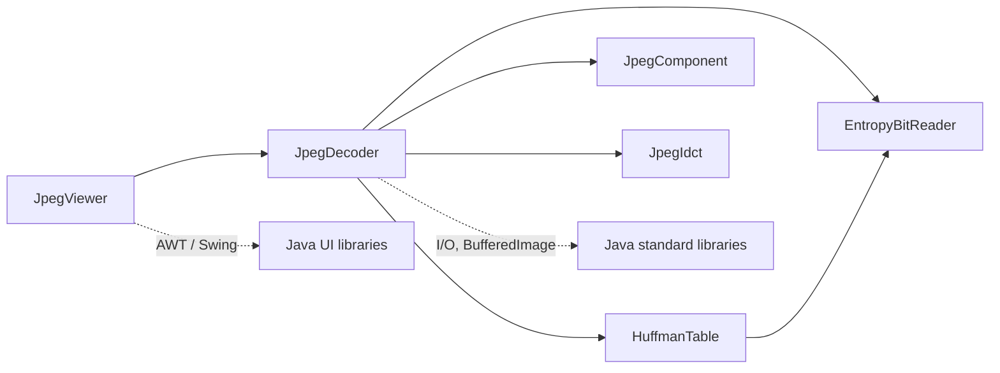
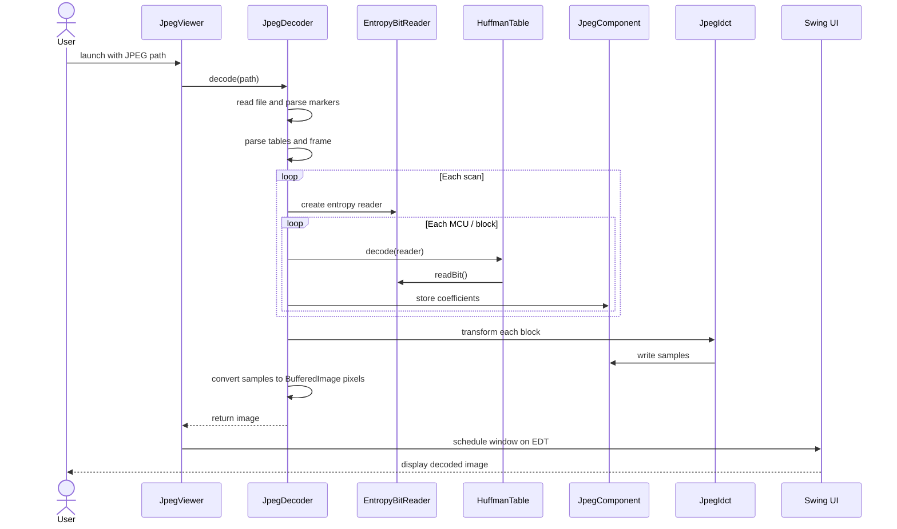

# Modular JPEG decoder

This Java 8 program reads JPEG bytes directly and decodes Huffman-coded baseline
and progressive JPEG images. It parses JPEG markers and quantization/Huffman
tables, decodes the entropy-coded scans, performs an inverse DCT, converts
grayscale/RGB/YCbCr samples to pixels, and displays the result in a Swing
window.

## Build and run

With GNU Make on Windows, build all Java sources into `build/` and launch the
viewer with:

```text
make
java -cp build JpegViewer ex.jpg
```

Run `make clean` to remove the generated build directory. To compile manually,
create `build/` and pass `-d build` to `javac`.

Pass any JPEG path as the single argument to `JpegViewer`.

## Modules

- `JpegDecoder` parses markers/scans, reconstructs coefficients, and renders
  pixels.
- `HuffmanTable` builds and decodes canonical JPEG Huffman tables.
- `EntropyBitReader` reads stuffed entropy bytes and restart markers.
- `JpegIdct` performs the inverse discrete cosine transform.
- `JpegComponent` stores one component's coefficient blocks and samples.
- `JpegViewer` displays the decoded `BufferedImage`.

### Class dependencies

The arrows show which project classes use other classes. The project classes
are in the default package, so their relationships do not appear as explicit
`import` statements.



### Runtime calling order



This implementation supports 8-bit Huffman-coded SOF0/SOF1/SOF2 images with
one or three components, including progressive scans and restart intervals.
Arithmetic-coded, lossless, 12-bit, and four-component CMYK/YCCK JPEGs are not
supported.
